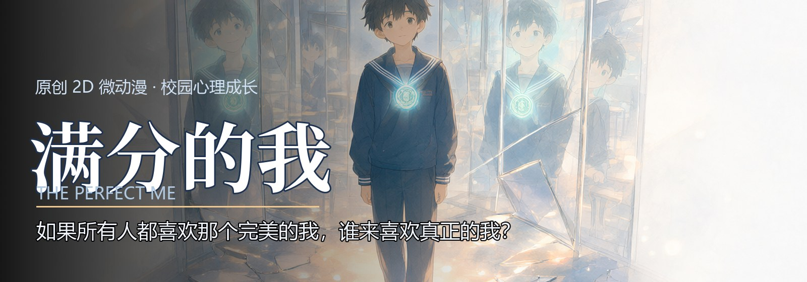
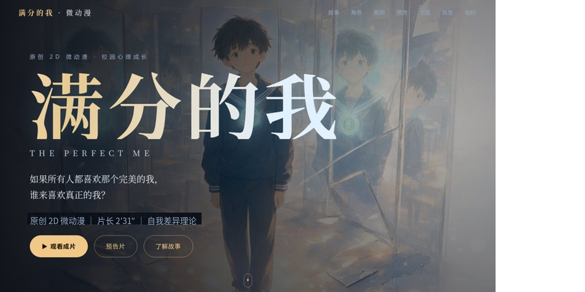
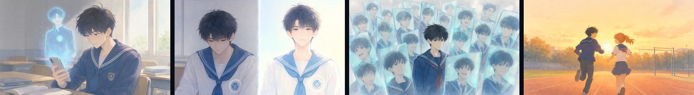
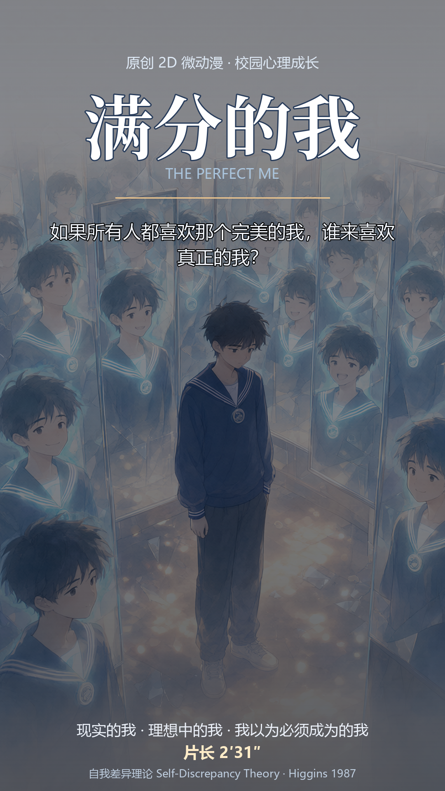

<div align="center">
  

  <h1>满分的我 · The Perfect Me</h1>

  <p><b>如果所有人都喜欢那个完美的我，谁来喜欢真正的我？</b></p>

  <p>
    <a href="https://zhubao315.github.io/perfectme/"></a>
    
    
    
    
  </p>

  <p>
    
    
    
    
    
    
  </p>

  <p>
    <a href="https://zhubao315.github.io/perfectme/">🌐 <b>在线网站</b></a> ·
    <a href="https://zhubao315.github.io/perfectme/10-宣传网站/">🎬 观看成片</a> ·
    <a href="00-文档总览.md">📖 项目文档</a> ·
    <a href="08-宣传物料/README.md">🎨 宣传物料</a>
  </p>
</div>

---

## ✨ 一句话

> **99 个赞，0 个人知道他不开心。** 他把自己修得完美无缺，却越来越不喜欢自己——直到朋友一句"那你不用在我面前装没事"。

《满分的我》是一部约 **2 分 31 秒**的**原创 2D 微动漫**。以 **自我差异理论**（Self-Discrepancy Theory, Higgins 1987）为内核，讲述每个在"别人眼中的我"与"真实的我"之间拉扯的少年。作品想说的不是"不要努力"，而是——**你可以努力成为更好的自己，但不必先变得完美，才配得到认可。**

## 🌐 在线访问

| | |
|---|---|
| 🖥️ **宣传网站** | **<https://zhubao315.github.io/perfectme/>** |
| 🎬 成片（**MiniMax H3 动画版**） | [`07-成片/满分的我-动画版-H3.mp4`](07-成片/满分的我-动画版-H3.mp4) ｜ 制作说明见 [`11-动画版H3制作说明.md`](11-动画版H3制作说明.md) |
| 🎬 成片（原程序化动画 · 配音版） | <https://zhubao315.github.io/perfectme/10-宣传网站/> |
| 📄 文档总览（网页/PDF） | [`00-文档总览.html`](00-文档总览.html) ｜ [`00-文档总览.pdf`](00-文档总览.pdf) |

## 🖼️ 预览

**宣传网站**
<br>


**剧照**
<br>


**角色**
<table>
  <tr>
    <td align="center" width="33%"><br><b>林一</b><br><sub>现实自我 · 主人公</sub></td>
    <td align="center" width="33%"><br><b>一林</b><br><sub>理想 / 应该自我</sub></td>
    <td align="center" width="33%"><br><b>陈晓</b><br><sub>朋友 · 陪伴者</sub></td>
  </tr>
</table>

<p align="center">
  
</p>

## 🎬 故事

高一男生**林一**，是班里"人缘很好、成绩不错"的那类人。社交平台上，他的照片被无数个赞包围；可镜头拉近，他独自坐在洗手间隔间里，屏幕里是阳光灿烂的自拍，脸上却没有笑。

由"想被喜欢"的渴望凝聚而成的虚拟自我**一林**不断提醒他：别让他们看出你不开心。他越来越努力，却越来越不喜欢自己。直到朋友**陈晓**一句"**那你不用在我面前装没事**"，让他第一次发现——真实的自己，也可以被接纳。

## 🧩 制作流程

```text
① 策划    完整剧本 ─▶ 分镜表 ─▶ 逐镜动画分镜
② 视觉    角色设定 + 6 轮提示词 ─▶ Qwen-Image-2.1 ─▶ 原创角色/场景/分镜图
③ 动画    分镜图 ─▶ 呼吸式镜头运动 (ffmpeg) / OpenToonz ─▶ 动态片段（原版）
   ③′ H3    分镜图 + 变体图 ─▶ MiniMax-H3 图生视频 ─▶ 真正运动的动画片段（动画版）
④ 音频    ACE-Step(配乐) + Qwen3-TTS(配音) + 自研音效 ─▶ 多轨
⑤ 合成    FFmpeg / Kdenlive ─▶ 成片（字幕版 / 配音版 / H3 动画版）
⑥ 宣传    主视觉 + 文案 + 预告片 ─▶ 宣传网站 & 物料
```

## 🛠️ 技术栈

| 环节 | 工具 |
|---|---|
| 角色 / 场景 / 分镜图 | **Qwen-Image-2.1**（本地，依据原创提示词） |
| 配乐 | **ACE-Step v1**（本地，纯器乐提示词） |
| 配音 | **Qwen3-TTS**（本地 GPUStack，VoiceDesign 三音色 + 播音员旁白） |
| 音效 | 自研程序化合成（纯 Python） |
| 绘修 / 动画 | Krita · OpenToonz |
| **动画版画面** | **MiniMax-H3 图生视频（fl2va，本地 ComfyUI，8 步 turbo）** |
| 剪辑 / 合成 | Kdenlive · FFmpeg |
| 宣传网站 | 原生 HTML / CSS / JS（Canvas 粒子、视差、滚动揭示，自包含） |

## 📂 目录结构

```text
.
├── index.html                   宣传网站入口（跳转）
├── 00-文档总览.md / .html / .pdf 文档总入口
├── 01-脚本/                     剧本 · 分镜表 · 逐镜动画分镜表
├── 02-提示词/                   6 轮原创提示词
├── 03-角色设定/                 三名原创角色设定
├── 04-分镜图/                   角色 / 场景 / 镜头 原创图像
├── 05-音频/                     配乐 · 配音 · 多轨
├── 06-工程源文件/               Kdenlive 工程 (.mlt)
├── 07-成片/                     成片（字幕版 / 配音版 / H3 动画版）+ 字幕
├── 08-宣传物料/                 主视觉 · 文案 · 预告片 · 落地页
├── 09-文档配图/                 统一风格文档插画
├── 10-宣传网站/                 炫酷单页宣传网站
├── 11-动画版H3制作说明.md       H3 动画重制流程与复现说明
└── build/                      可复现脚本与中间产物（含 build/h3/）
```

## 🚀 一键复现

```bash
python3 build/build.py        # 合成字幕版成片
python3 build/ace_gen.py      # 生成配乐（ACE-Step）
python3 build/tts_dub.py      # 生成配音（Qwen3-TTS）
python3 build/sfx_gen.py      # 生成音效
python3 build/mix_dub.py      # 多轨混音 + 配音版成片
python3 build/promo_gen.py    # 宣传主视觉 / 海报 / 角色卡
python3 build/make_trailer.py # 预告片
python3 build/site_build.py   # 准备宣传网站资源

# H3 动画版（需本地 comfyui-minimax-h3-video 服务 healthy）
python3 build/h3/01-build-manifest.py      # 生成逐镜任务清单
python3 build/h3/02-generate-clips.py      # MiniMax-H3 逐镜生成（自动跳过已完成）
python3 build/h3/03-assemble.py            # 套回原配音字幕，合成动画版成片
```

> 本地预览网站：`cd 10-宣传网站 && python3 -m http.server 8791`

## 📖 文档

完整文档见 **[`00-文档总览.md`](00-文档总览.md)**：剧本、分镜、角色、提示词、音频、工程、宣传、投稿合规一应俱全。H3 动画版的重制流程见 **[`11-动画版H3制作说明.md`](11-动画版H3制作说明.md)**。

## ⚖️ 原创声明

角色、场景、剧情、台词、分镜、提示词均为**原创设计**；角色与场景图像由本地 **Qwen-Image-2.1** 依据本项目原创提示词生成，H3 动画版画面由本地 **MiniMax-H3** 依据原创分镜图/变体图生成，配乐由本地 **ACE-Step** 生成，配音由本地 **Qwen3-TTS** 合成，音效由本项目脚本程序化合成。**不含任何网络下载、搜集或破解的第三方素材。**

---

<div align="center">
  <p><i>你可以努力成为更好的自己，但不必先变得完美，才配得到认可。</i></p>
  <p><b>《满分的我》</b> · 原创 2D 微动漫</p>
  <p><sub>© 2026 · 保留所有权利</sub></p>
</div>
